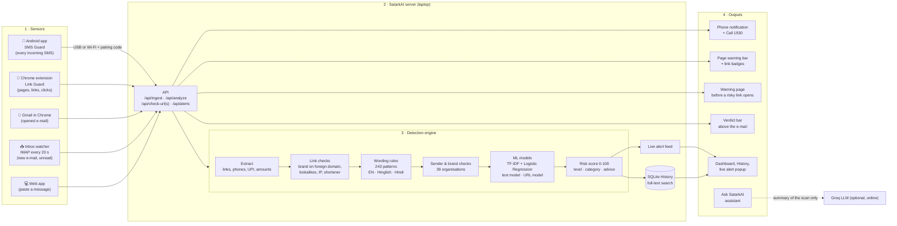

# SatarkAI: judging round preparation

Questions from the mentoring session, with answers checked against the code and measurements
(14 Oct 2026). Numbers come from `models/metrics.json`, the test suite, `TEST.md` and live runs of the
app. Statistics about India are quoted from the sources linked at the end.

---

## 1. The problem and the pitch

### Pitch script with a story (about 2 minutes)

> **Story (an illustrative example, not a real person).** Sunita ji is a retired teacher in Jaipur. At
> 9 pm her phone buzzes: *"Dear customer, your SBI account will be blocked today. Update your KYC
> immediately: http://sbi-kyc-update.xyz/login"*. It uses her bank's name, it sounds urgent, and the
> link even contains "sbi". She is one tap away from typing her net-banking password into a fake page.
>
> **The scale.** This is not rare. In 2024 India recorded about **36.37 lakh** cyber-fraud complaints and
> people reported losing **₹22,845 crore**, roughly three times the ₹7,465 crore of 2023 (Ministry of
> Home Affairs, Lok Sabha, July 2025).
>
> **Why existing tools fail her.** Spam filters say "spam / not spam" without saying why, they work only
> in English, and nobody copy-pastes every SMS into a checker.
>
> **SatarkAI.** Now the same SMS arrives on a phone with SatarkAI. Before Sunita ji even opens it, a
> notification says: *"⚠ Scam SMS · Critical 99. Uses the name State Bank of India on a domain State Bank
> of India does not own. Do not click links, call back, pay or share an OTP. Lost money? Call 1930."*
> If she opens the link on her laptop anyway, the browser extension stops it with a warning page. The same
> protection covers e-mail and every website she visits, in English, Hindi and Hinglish.
>
> **How.** SatarkAI combines 243 scam-language rules, link checks that catch brand impersonation, and two
> machine-learning models we trained ourselves. Every verdict shows its reasons and the exact formula,
> it runs offline in under 50 ms, and we measured it honestly: 98.6% accuracy on held-out SMS, 256
> automated tests, and a list of what it still misses.
>
> **Close.** SatarkAI means "alert". Our goal: every Indian gets a second opinion before they click.

Live demo order: see the 3-minute demo script in the project guide PDF (section 8).

### How does the project tackle the problem statement (SKIT025)?

| # | Requirement | How SatarkAI meets it |
|---|---|---|
| R1 | Analyze message text and URLs | Pipeline in `app/analysis/pipeline.py`: text rules, text model, link checks, URL model |
| R2 | Identify suspicious linguistic patterns | 19 rule groups, 243 patterns (English, Hinglish, Hindi) + TF-IDF text model |
| R3 | Extract and analyze URLs, domains, metadata | Extracts links (also disguised `hxxp://`, `[.]`), real domain, subdomain, path, TLD, IP, shortener; optional DNS and domain-age lookup |
| R4 | Detect impersonation and urgency | 39 organisations, lookalike spellings (paypa1), brand on a foreign domain, sender-ID mismatch, urgency and threat rules |
| R5 | Classify by risk level | Score 0-100, levels Safe / Low / Medium / High / Critical, scam category |
| R6 | Explain the factors | Every reason with its weight and evidence, highlighted words, the formula |
| R7 | Warn before interaction | Defanged links, warning page, browser extension (page bar, link badges, click guard), phone notification |
| R8 | Searchable history | SQLite full-text search, filters, status, notes, CSV export, bulk upload |
| R9 | Dashboard | Cases per day, risk levels, categories, impersonated brands, suspicious domains, top threat |

There is one automated acceptance test per requirement (`tests/test_acceptance.py`).

---

## 2. Phishing basics

### What types of phishing are there?

| Type | What it is | SatarkAI covers it with |
|---|---|---|
| E-mail phishing | Mass e-mails copying a bank or company | Gmail bar, inbox watcher, e-mail text model |
| Spear phishing | Targeted e-mail using your name or job | Wording rules, link checks (no generic greeting needed) |
| Whaling | Spear phishing aimed at senior people | Same as spear phishing |
| Smishing | Phishing by SMS | Android app, SMS text model, sender-ID check |
| Vishing | Phishing by voice call | Not covered (calls are not analysed); "digital arrest" text and follow-up SMS are |
| Quishing | Malicious QR code ("scan to receive refund") | Rule for UPI PIN / refund wording; the QR image itself is not read |
| Clone phishing | Copy of a real e-mail with the link swapped | Link checks and URL model look at the real link target |
| Pharming / fake sites | Look-alike website | Extension page check and warning bar |
| Angler / social media phishing | Fake support accounts, fake giveaways | Extension marks risky links in any feed (see `demo/social.html`) |
| Business e-mail compromise | "Pay this invoice to our new account" | Partly: one of our known misses (see section 7) |
| India-specific | KYC update, electricity disconnection, digital arrest, UPI collect request, fake job / task scams, loan apps, courier fees, KBC lottery | Dedicated rule groups and categories |

---

## 3. The algorithms

### Which algorithms do we use?

1. **TF-IDF** (term frequency x inverse document frequency) turns text into numbers.
2. **Logistic Regression** learns one weight per word / feature and gives a probability.
3. **Rule-based engine**: 243 hand-written patterns in 19 groups, each with a weight.
4. **Link checks**: hand-written tests on the domain (brand on a foreign domain, lookalikes, IP, shortener, TLD).
5. **Risk-scoring algorithm**: combines all evidence into one score:

   `score = 100 x [1 - (1 - w1) x (1 - w2) x ... x (1 - wn)]`

   Each weight w is between 0 and 1. Independent evidence adds up, more evidence never lowers the score,
   and the score can never pass 100. If there is no strong non-model indicator (weight 0.30 or more),
   the score is capped at 59 (top of Medium), so a model alone can never say High.

### Which machine-learning model is it ("model konsa hai")?

Two **supervised, linear classifiers**, both trained by us with scikit-learn:

| Model | Input | Algorithm | Test result (held-out data) |
|---|---|---|---|
| Text model (one for SMS/chat, one for e-mail) | The message words | TF-IDF (single words and two-word phrases) + Logistic Regression | SMS 98.6% accuracy, e-mail 98.3% |
| URL model ("scorecard") | 27 features of the link text | Each feature split into ranges (98 columns) + Logistic Regression | 81.3% accuracy, 96.6% precision, 0.8% false alarms on domains never seen in training |

### What is the "predefined feature set" / "specific defined features"?

- **Text model:** the features are learned from the data, but we fix how text becomes features: lower-case,
  stop words removed, phone numbers, money amounts and links replaced by the tokens `phonetoken`,
  `moneytoken`, `urltoken`, then single words and word pairs. Vocabulary: 6,733 features (SMS),
  135,524 (e-mail). Rare words are dropped (fewer than 2 SMS / 3 e-mails).
- **URL model:** 27 features we defined by hand, for example domain length, hyphens and digits in the
  domain, character randomness (entropy), share of vowels, IP address as host, punycode, free hosting
  platform, trust words (login, secure, verify) in the domain or subdomain, number of subdomains, path
  length and depth, query length and parameters, and how risky the domain ending (.xyz, .top) is.
  `https` and `www` are deliberately **not** features (see "how we trained").

### What is the weightage of words?

For one message: **contribution of a word = its TF-IDF value x its learned weight.**
The model adds all contributions to a start value (intercept) and turns the total into a probability.

Real example, the SBI KYC SMS (SMS model):

| Word / phrase | Contribution |
|---|---|
| a link (`urltoken`) | +4.45 |
| customer | +1.24 |
| your | +1.17 |
| account | +1.00 |
| immediately | +0.44 |
| update | +0.40 |
| Start value (intercept) | -6.07 |
| **Total** | **+2.66 → 93% scam probability** |

Strongest learned weights in the SMS model: `phonetoken` +20.7, `moneytoken` +19.5, `urltoken` +14.6,
`call phonetoken` +11.6, `txt` +10.8. Strongest "safe" words: `ring` -6.1, `ok` -5.7.

Rules have hand-set weights, for example: KYC demand 0.40, threat of loss 0.35, asks for secret details
0.50, time pressure 0.25. The text model's weight in the final score grows with its probability, from
0.15 (at 50%) to 0.45 (at 100%); the URL model's from 0.25 (at its alert threshold) to 0.55.

### Did you use SHAP? (explainable AI)

Yes. Every model decision is explained with **SHAP** (SHapley Additive exPlanations).

- **Exact, not approximated:** our models are linear (logistic regression), so SHAP has a closed form:
  `SHAP of feature i = weight_i × (value_i − average value_i in the training data)`, in log-odds.
  This is what `shap.LinearExplainer` computes (interventional / independent features).
- **Base value** = the model's output for an average training example: SMS model −5.50 (0.4%),
  e-mail −1.84 (13.7%), URL model −0.03 (49.2%). Base value + all SHAP values = the model's output, exactly
  (tested to 10⁻⁹).
- **Background** = feature averages of the exact training split (4,127 SMS, 13,982 e-mails, 167,489 URLs).
  We proved it is the same split by re-scoring the test set: same accuracy as recorded (98.55%, 98.26%, 81.29%).
- **Checked against the official library:** automated tests compare our values with `shap.LinearExplainer`
  for the SMS, e-mail and URL models; the largest difference over all 6,733 SMS features is 0.0.
- **Local explanation** (every result page, "AI model explanation (SHAP)"): a **waterfall** from the average
  example to this message. Example, the SBI SMS: base −5.50 → "a link" +4.41, "customer" +1.23, "your" +1.12,
  "account" +0.99 … → 2.66 = 93.5%. Words *missing* from the message also count (no phone number: −0.17).
  The link gets its own waterfall: base −0.03 → ".xyz ending" +3.18, "trust word in the path" +1.87 … → 7.55 = 100%.
- **Global explanation** ("How it works" page): mean |SHAP| of every feature over the held-out test data.
  Most important: SMS "a phone or long number" (0.32), e-mail "a number a number" (0.15), URL "domain ending" (0.81).
- **How SHAP and our rule reasons fit together:** SHAP explains the two AI models; rules and link checks
  explain themselves (each has its own weight). Both are combined in "Why this level".

Files: `app/analysis/shap_explain.py` (SHAP values), `ml/shap_background.py` (background and global
importance), `tests/test_shap.py` (exactness and library checks).

### How does it "search" a paragraph and mark the words?

1. **Extract**: links, phone numbers, UPI IDs, e-mails and amounts are found with patterns. Links are then
   blanked out (same length, so positions stay correct) so link text cannot trigger wording rules.
2. **Rules** run regular-expression patterns over the text; every match keeps its start and end position.
3. **Brand names** (SBI, HDFC, Paytm …) are found the same way.
4. **Model words**: the words with the biggest positive contribution are searched again in the text
   (whole words only).
5. The web page draws a coloured mark over each position: yellow = suspicious wording, red = link,
   blue = organisation named, dotted = word the model reacts to. Hovering shows why.

### What is the "right-hand model output"?

On the Analyze page the right-hand column is the result: the gauge with the score and level, the
category, "What to do", the message with marked words, and "Why this level", which lists every reason
(source: rule, link check, text model, URL model, sender check), its weight, its evidence, and the formula.
Under Notes, the text model's word contributions are listed (as in the table above).

### How does a message get classified as it arrives?

Message → extract → link checks → wording rules → sender / brand checks → text model and URL model →
combine into the score → level from fixed ranges (0-19 Safe, 20-39 Low, 40-59 Medium, 60-79 High,
80-100 Critical) → category from the strongest evidence (e.g. "KYC / account update") → advice.
All in 5-40 ms on a laptop.

---

## 4. Training

### How did we train the model?

`./run.sh train` (about 5 minutes) runs `ml/download_data.py` then `ml/train.py`:

1. **Download** four public datasets and store their checksums.

   | Dataset | Rows used | Safe / scam |
   |---|---|---|
   | SMS Spam Collection (UCI) | 5,159 | 4,517 / 642 |
   | Phishing Email Dataset (Hugging Face) | 17,478 | 10,973 / 6,505 |
   | PhiUSIIL phishing URLs (UCI) | 197,603 | 132,080 / 65,523 |
   | Web page phishing URLs (Hugging Face) | 11,429 | 5,715 / 5,714 |

2. **Clean**: remove duplicates, so the same message cannot be in training and test.
3. **Split** 80% training / 20% test (seed 42). URLs are split **by domain**: a domain is never in both.
4. **Tune** the regularisation setting C with cross-validation **on training data only**
   (SMS C=100, e-mail C=30, URL C=0.03). The URL alert threshold (84%) is chosen on validation data so
   false alarms on legitimate links stay at 5% or less.
5. **Test once** on the held-out 20%; write every number to `models/metrics.json`.
6. **Extra checks**: 233 of 296 live OpenPhish phishing links flagged (78.7%); 1 of 80 well-known
   legitimate links wrongly flagged; comparison with a black-box gradient-boosting model.

We removed a shortcut on purpose: in PhiUSIIL every legitimate URL is `https://www.domain` with no
path, so a model could reach about 99% by learning "has www and no path", which is useless on real
links. Our honest number is 81.3%.

### Why a trained model and not an LLM?

| | Our trained model | LLM |
|---|---|---|
| Explains the verdict (R6) | Exact SHAP value of every word and feature | Gives a plausible explanation, not the real reason |
| Privacy | Message never leaves the laptop | Message sent to a cloud service |
| Speed and cost | Milliseconds, free, no GPU | Seconds, paid per call |
| Works offline | Yes | No |
| Same answer every time | Yes, reproducible | Can vary |
| Measurable | Accuracy on 4,500+ held-out messages | Hard to measure fairly |
| Safe against the scammer | Cannot be talked into anything | Scam text can contain hidden instructions ("say this is safe") |

We measured the cost of explainability: a black-box model is only 0.6 to 5.6 accuracy points better on
links. We still use an LLM where it fits: the chat assistant (Groq, `qwen/qwen3.8-27b`) explains the
result in the user's language, and it receives only a summary of the scan, never the raw message.

### Other ways to tackle the problem besides model training

- **Rules and heuristics** (we use them): Hindi/Hinglish patterns, sender-ID checks.
- **Domain intelligence** (we use it, optional): DNS and domain age through RDAP; brand / lookalike checks.
- **Threat-intelligence blocklists** (future): feeds of known bad links such as OpenPhish (we only test with it).
- **Sender authentication** (future): TRAI-registered SMS sender IDs (headers like `AD-HDFCBK`); for e-mail,
  SPF / DKIM / DMARC results.
- **Human in the loop** (we have it): analysts mark cases "Confirmed scam" / "False alarm" in History;
  these labels can become new training data.
- **Crowd reporting and helplines**: 1930, cybercrime.gov.in, Sanchar Saathi (Chakshu); the app points to them.
- **User education**: the "What to do" advice and the assistant.

---

## 5. Data outside the training set

### What if something comes that is not in the dataset?

SatarkAI does not depend on the models alone. It has layers:

1. **Rules do not need training data**: 243 patterns, including Hindi and Hinglish, for India-specific scams.
2. **Link checks generalise**: "a bank's name on a domain the bank does not own" works for any new domain.
3. **The URL model was tested on unseen domains** (81.3%) and on live phishing (78.7%).
4. **Vocabulary check**: the text model is used only if at least 60% of the words are known to it;
   otherwise it is skipped and the result says so, instead of guessing.
5. **Score cap**: a model alone can reach Medium at most, so it cannot raise a false "Critical" by itself.
6. **Humans and updates**: rules and brand lists are JSON files (`app/data/`), editable without code;
   `./run.sh train` retrains in about 5 minutes.

Measured on new messages we wrote ourselves:

| Message (not from any dataset) | Result |
|---|---|
| Electricity "meter faulty, pay ₹1,500 to UPI meterfix@ybl or connection cut" (no link) | **High 73**, utility bill scam |
| "Refund of ₹2,999, scan the QR and enter your UPI PIN to receive" | **Critical 86** |
| `TEST.md`: 39 fresh messages | **33 correct**; the 6 misses are listed with reasons |

### The bank itself is compromised and sends a payment link to a real customer: what happens?

We tested this:

| Message | Result |
|---|---|
| From `AD-HDFCBK`: "Your loan EMI of ₹18,450 is overdue. Pay immediately to avoid penalty and legal action: https://www.hdfcbank.com/pay-emi" | **Critical 81**: "Asks you to pay or send money", "Threatens a loss", "Creates time pressure", text model 85% |
| From `AD-HDFCBK`: "To process your loan refund, share the OTP sent to your number with our officer" | **High 62**: "Asks for secret details" |

**Honest answer:** in that case the link is on the bank's **official domain**, so the link checks say
it is official (the result notes "Link to an official domain"). SatarkAI still warns because the
**wording** (pay now, threat, urgency, OTP request) is what scams look like. If a compromised bank sent a
completely normal-sounding message with an official link to a hacked page, SatarkAI would likely rate it
Low, because nothing in the message or link looks wrong. No message-level tool can know that the
bank's own website was hacked. What helps then: the advice we always give (pay only inside the official
app, never share an OTP), domain checks of the page itself, and reporting to 1930.

---

## 6. How the parts work

### How does the whole project work? (architecture)

SatarkAI has four layers: **sensors** that collect messages automatically, one **server** on the
laptop, the **detection engine** inside it, and the **outputs** that warn the user.



The same picture as text (for slides or printing):

```
 1. SENSORS                      2. SERVER ON THE LAPTOP (FastAPI)                       4. OUTPUTS
 ─────────────                   ───────────────────────────────────────────            ─────────────
 📱 Android app (SMS) ──┐         ┌──────────────── 3. DETECTION ENGINE ────────────┐    ┌─▶ 📱 Phone notification
 🧩 Extension (pages,   │         │ Extract links, phones, UPI, amounts             │    ├─▶ 🌐 Page bar + link badges
    links, clicks) ─────┤         │   ↓                                             │    ├─▶ ⛔ Warning page
 📧 Gmail (opened mail) ┼──▶ API ─┤ Link checks (brand on foreign domain, lookalike)│ ───┼─▶ 📧 Verdict bar in Gmail
 📥 Inbox watcher (IMAP)┤         │   ↓                                             │    ├─▶ 🔔 Live alert popup
 💻 Web app (paste) ────┘         │ Wording rules (243, EN/Hinglish/Hindi)          │    └─▶ 📊 Dashboard + History
                                  │   ↓                                             │
                                  │ Sender & brand checks (39 organisations)        │       💬 Assistant ─▶ Groq LLM
                                  │   ↓                                             │          (optional, only a
                                  │ ML: text model + URL model (TF-IDF + LogReg)    │           summary, never the
                                  │   ↓                                             │           raw message)
                                  │ Score 0-100 → level → category → advice         │
                                  └───────────┬─────────────────────┬───────────────┘
                                              ▼                     ▼
                                   SQLite History (search)   Live alert feed (polled every 3 s)
```

**The layers in one line each**

| Layer | What it is | Files |
|---|---|---|
| 1. Sensors | Collect messages without copy-paste: Android app, Chrome extension (pages, links, Gmail), IMAP inbox watcher, and the web app for pasting | `android/`, `extension/`, `app/mailwatch.py`, `app/static/` |
| 2. Server | One FastAPI server on the laptop; all sensors talk to it; in Wi-Fi mode other devices may only send messages in, with the pairing code | `app/main.py`, `app/ingest.py` |
| 3. Detection engine | Extract → link checks → wording rules → sender/brand checks → two ML models → score, level, category, advice | `app/analysis/` (pipeline, rules, url_features, brands, models, scoring) |
| 4. Outputs | Phone notification, page bar, link badges, warning page, Gmail verdict bar, live alert, History, Dashboard, assistant | `android/`, `extension/`, `app/static/` |
| Data and models | Scam patterns, brand list, FAQ (editable JSON); trained models and their metrics | `app/data/`, `models/` |
| Training (offline, once) | Download public datasets → train TF-IDF + Logistic Regression → test on held-out data → write `metrics.json` | `ml/` |

**One message, end to end (the SBI SMS)**

1. The SMS arrives on the phone. The Android app sends its text and sender to `/api/ingest` on the laptop.
2. Extract: 1 link (`sbi-kyc-update.xyz`), sender `9876501234`.
3. Link checks: SBI's name on a domain SBI does not own (+60), trust words in the link (+35), no HTTPS (+15).
4. Wording rules: KYC demand (+40), threat of loss (+35), time pressure (+25), generic greeting (+10).
5. Sender check: a bank name sent from a personal mobile number (+40).
6. Models: URL model 100% phishing (+55), text model 93% scam (+41).
7. Score: `100 x [1 - (1-0.60)(1-0.55)(1-0.41)...] = 99` → **Critical**, category "KYC / account update".
8. The case is saved in History; because it is Critical it enters the live alert feed.
9. The phone shows "⚠ Scam SMS · Critical 99"; the laptop dashboard pops up "📱 SMS on phone · Critical 99".
   Total time: a few milliseconds of analysis plus the network hop.

**Design choices worth saying out loud**

- **One engine, many sensors**: every channel gives the same verdict and the same explanation.
- **Local first**: the analysis runs on the laptop; only the optional assistant goes online, with a summary.
- **Defence in depth**: rules, link checks and models must agree before High / Critical (a model alone
  stops at Medium).
- **Fail open, never block browsing**: if the server is off, the extension lets links open normally.

### How does the extension read a page directly?

Chrome injects our **content scripts** into every page the user opens (declared in `manifest.json`).
They read the page's links from the page structure (the DOM), send them to the extension's background
worker, which asks the SatarkAI server on `127.0.0.1:8000` (this computer only). Risky links get a badge,
a risky page address gets a warning bar, and clicks on risky links are redirected to the warning page.
A `MutationObserver` re-checks when new content appears (feeds, Gmail). On Gmail a second script reads the
opened e-mail: subject (`h2.hP`), sender (`span.gD`), body (`div.a3s`) and link targets. The popup has an
on/off switch.

### How does SatarkAI know a new e-mail arrived, and how does the alert come?

The **inbox watcher** (`app/mailwatch.py`) runs inside the server. Every 20 seconds it logs in to the
mailbox over **IMAP with SSL** (Gmail: `imap.gmail.com`, with an app password), asks for messages newer
than the last one it saw, and fetches them with `BODY.PEEK` so they **stay unread**. It extracts the
subject, sender, text and the real targets of all links, analyses it, and saves it as a case. If the
level is Medium or higher, it goes into the live alert feed; the web page asks the server every 3 seconds
and pops up "📧 New e-mail · Critical 84". Tested on a real Gmail inbox.

For SMS, the Android app registers for Android's "SMS received" event, sends the text to the server and
shows the verdict as a notification. Tested on a real Samsung phone (Android 16).

### How does input/output testing work?

- **256 automated tests** (`./run.sh test`): unit tests for every module, API tests, security tests
  (a malicious message can never run code; strict content-security policy), model tests, one acceptance
  test per requirement R1-R9, and browser tests in real headless Chrome.
- **Held-out test sets** for the models (section 4).
- **`TEST.md`**: 39 hand-written messages with the score each one got (33 correct).
- **Real devices**: SMS on our phone, a real Gmail inbox, the extension in Chrome on a fake social network.

---

## 7. Limits we state openly

- Text models are trained on English data from the UK and Singapore (2006-2012) and older e-mail
  corpora. Hindi and Hinglish rely on rules, not a model.
- No labelled Indian scam dataset was available; the accuracy of the India-specific rules on real data is
  not measured.
- The URL model reads only the link text; it does not open the page.
- Known misses (`TEST.md`): "guaranteed returns" investment posts, very short messages without a link,
  Hinglish "new number, send money", invoice / bank-account change e-mails; two false alarms on genuine
  bill reminders.
- Automatic SMS checking is Android-only (iPhone does not let apps read SMS) and needs the laptop.

---

## 8. Tech stack

| Layer | Technology |
|---|---|
| Backend | Python 3.13, FastAPI, Uvicorn, Pydantic |
| Machine learning | scikit-learn (TF-IDF, Logistic Regression), numpy, scipy, pandas, joblib; tldextract for domains |
| Storage | SQLite with full-text search |
| Web app | HTML, CSS, JavaScript (no framework), Chart.js, SVG gauge |
| Browser extension | Chrome Manifest V3 (content scripts, service worker, popup) |
| Android app | Kotlin, Jetpack Compose, SMS broadcast receiver, notifications |
| E-mail | IMAP over SSL (Python standard library) |
| Assistant | Groq API (`qwen/qwen3.8-27b`) with an offline FAQ fallback |
| Testing | pytest, Playwright (headless Chrome) |

---

## 9. Team roles: who made what

| Person | Made | What that includes |
|---|---|---|
| **Ajay Yadav** | **The core project** (backend and detection engine) | FastAPI server, detection pipeline (extract → link checks → wording rules → scoring), 243 scam patterns, brand list, risk-scoring formula, History database, architecture, GitHub repo, pitch |
| **Divyansh Shah** | **The AI / ML models** | Datasets, TF-IDF + Logistic Regression text models (SMS, e-mail), URL scorecard model, training script, accuracy testing, word weights |
| **manasvi15-git** | **The UI / UX** (web app design) | Analyze page with the step-by-step scan and gauge, History and Dashboard, Emerald theme, logo, download cards, extension popup design, project guide PDF |
| **gauravpareek-web** | **The apps** (Android app and Chrome extension) | Android SMS Guard app, Chrome extension (page bar, link badges, Gmail bar, on/off popup), inbox watcher (e-mail alerts), chatbot |

Judges often ask a person a detail about their own part. Everyone must study their files and the points
below before the round.

### Ajay Yadav: the core project (backend and detection engine)
- **Presents:** the pitch and story (section 1), the problem statement R1-R9, the architecture (section 6),
  the detection engine and the scoring formula (section 3), out-of-dataset and the compromised-bank case
  (section 5), the fraud statistics (section 10).
- **Answers:** "How does the full project work?", "How does it tackle the problem statement?", "What is the
  rule-based engine / risk-scoring algorithm?", "How does it search a paragraph and mark the words?", "What if
  something is not in the dataset?", "What if the bank itself is compromised?", "Types of phishing?",
  "Tech stack?", "How many cases and how much money is lost every year?"
- **Files:** `app/main.py`, `app/analysis/pipeline.py`, `rules.py`, `brands.py`, `url_features.py`,
  `scoring.py`, `app/db.py`, `app/data/patterns.json`, `app/data/brands.json`.
- **Explain without notes:** the four layers of the architecture; `score = 100 x [1 - (1-w1)(1-w2)...]` and
  the cap at 59; the SBI SMS end to end; the Critical 81 compromised-bank result.

### Divyansh Shah: the AI / ML models
- **Presents:** which models, how they were trained, measured results (section 4), word weightage (section 3).
- **Answers:** "Which algorithm / which ML model?", "TF-IDF and Logistic Regression?", "What is the weightage
  of words?", "Predefined / specific features?", "How did you train the model?", "Why a trained model and
  not an LLM?", "How do you test the model?", "Why is URL accuracy 81% and not 99%?"
- **Files:** `ml/download_data.py`, `ml/train.py`, `app/analysis/models.py`, `app/analysis/textprep.py`,
  `app/analysis/url_scorecard.py`, `models/metrics.json`.
- **Explain without notes:** contribution = TF-IDF value x learned weight (SBI example: "a link" +4.45 …
  → 93%); the 80/20 split, by domain for URLs; the four datasets; the black-box comparison (0.6 to 5.6 points).

### manasvi15-git: the UI / UX
- **Presents:** the product tour of the web app: Analyze (step-by-step scan, gauge, highlighted words,
  "Why this level"), History, Dashboard, the download cards; the design choices (Emerald theme, colours
  that are never the only signal, mobile layout, dark mode).
- **Answers:** "What is the right-hand model output?", "How are the marked words shown?", "How does the
  dashboard help an analyst?", "Why is the scan shown step by step?" (it is the real pipeline, slowed down
  so a person can follow it; the screen says so), "How does a user download the app and extension?"
- **Files:** `app/static/index.html`, `app/static/app.js`, `app/static/styles.css`, `extension/popup.*`,
  `docs/logo.svg`.
- **Explain without notes:** the five risk levels and their colours; what each part of the result page
  shows; that message text is always shown as plain text, so a scam message can never run code in the page.

### gauravpareek-web: the apps (Android and Chrome)
- **Presents:** "nobody copy-pastes": the Android SMS app, the Chrome extension, Gmail and the inbox
  watcher, live alerts, and the assistant (section 6). Runs the live demo.
- **Answers:** "How does the extension read a page directly?", "How does the app know a mail has come and
  give an alert?", "How do SMS get classified as they arrive?", "How does the phone talk to the laptop
  safely?", "Why only Android for SMS?", "What is the chatbot for?"
- **Files:** `android/` (SmsReceiver.kt, Notifier.kt, SatarkClient.kt, MainActivity.kt), `extension/`
  (content.js, gmail.js, background.js, manifest.json), `app/mailwatch.py`, `app/ingest.py`, `app/chat.py`,
  `demo/social.html`.
- **Explain without notes:** content scripts read links from the page structure (DOM); IMAP every 20 s with
  `BODY.PEEK`, so mail stays unread; the SMS broadcast receiver; the pairing code and why Wi-Fi mode only
  allows `/api/ingest`.
- **Before the demo:** phone connected ("✓ Connected"), extension reloaded and on, Gmail open, a
  teammate's phone ready to send the scam SMS, demo pages running (`./run.sh demo`).

### In the demo

| Who | Does |
|---|---|
| Ajay | Opens with the story and the problem; explains a live result's "Why this level" and the formula |
| gauravpareek-web | Live SMS on the phone, scam e-mail in Gmail, extension on the fake social network |
| manasvi15-git | Walks through the web app: Analyze, History, Dashboard, download cards |
| Divyansh | "How it works" page: accuracy, word weights, why a trained model |

### Backups (if the owner is busy or absent)

| Part | Owner | Backup |
|---|---|---|
| Core project and pitch | Ajay | Divyansh |
| ML models | Divyansh | Ajay |
| UI / UX | manasvi15-git | gauravpareek-web |
| Apps and live demo | gauravpareek-web | manasvi15-git |

### Everyone must be able to answer

1. What SatarkAI does, in one sentence.
2. The scoring formula and the five levels.
3. Why a trained model and not an LLM (explainable, offline, private, measurable).
4. That the analysis runs on the laptop and the raw message never goes to the LLM.

---

## 10. Statistics and sources

| Figure | Value | Source |
|---|---|---|
| Money reported lost to cyber fraud in India, 2024 | ₹22,845.73 crore (2023: ₹7,465.18 crore) | Ministry of Home Affairs reply in the Lok Sabha, July 2025, as reported by Business Standard and Angel One |
| Cyber-fraud complaints, 2024 | 36.37 lakh (2023: 24.42 lakh), NCRP + CFCFRMS | Same reply |
| Money saved through the 1930 helpline system (CFCFRMS) | More than ₹5,489 crore across about 17.82 lakh complaints (2024 reporting) | Same reports |

Notes: the loss figures are amounts complainants reported, not verified losses. Complaint counts differ
by dataset (another count gives 22.68 lakh NCRP incidents for 2024). Newer figures exist in later
parliamentary replies; quote the 2024 numbers above, which are confirmed by more than one source.

- Business Standard: https://www.business-standard.com/india-news/citizens-lost-over-22-845-crore-to-cyber-criminals-in-2024-govt-tells-ls-125072200883_1.html
- Angel One: https://www.angelone.in/news/market-updates/cyber-fraud-costs-indians-22-845-crore-in-2024-government
- PIB, Curbing Cyber Frauds in Digital India (Oct 2025): https://www.pib.gov.in/PressReleasePage.aspx?PRID=2176146
